# Mapa Visual de Arquitectura y Grafo de Dependencias

> **MÉTRICAS DE TOKENS:**
> - Archivos analizados: **19**
> - Símbolos exportados: **30**
> - Tokens código fuente completo: ~**15792** tokens
> - Tokens del grafo compacto: ~**556** tokens
> - **Ahorro de Tokens: 96%**

```mermaid
graph TD
  src_cli_ts["cli.ts<br/>()"]
  src_core_auto_runner_ts["auto-runner.ts<br/>(TaskStatus, MicroTask, AutoRunResult...)"]
  src_core_bridges_ts["bridges.ts<br/>(SupportedBridge, SyncReport)"]
  src_core_clarifier_ts["clarifier.ts<br/>(ClarificationQuestion, generateClarificationSession, formatClarificationMarkdown)"]
  src_core_config_ts["config.ts<br/>(SeverityLevel, SddConfig, DEFAULT_CONFIG)"]
  src_core_ears_validator_ts["ears-validator.ts<br/>(EarsType, EarsRequirement, ValidationIssue...)"]
  src_core_project_graph_ts["project-graph.ts<br/>(GraphNode, ProjectGraph, formatMermaidGraph)"]
  src_core_reverse_engine_ts["reverse-engine.ts<br/>(ProjectScanResult, generateReverseConstitution, generateReverseBaselineSpec)"]
  src_index_ts["index.ts<br/>()"]
  src_utils_fs_helpers_ts["fs-helpers.ts<br/>()"]
  src_utils_git_client_ts["git-client.ts<br/>(GitStatus, GitClient)"]
  src_utils_logger_ts["logger.ts<br/>(ArbiterRole, Logger)"]
  tests_auto_runner_test_ts["auto-runner.test.ts<br/>()"]
  tests_bridges_test_ts["bridges.test.ts<br/>()"]
  tests_config_test_ts["config.test.ts<br/>()"]
  tests_ears_validator_test_ts["ears-validator.test.ts<br/>()"]
  tests_project_graph_test_ts["project-graph.test.ts<br/>()"]
  tests_reverse_engine_test_ts["reverse-engine.test.ts<br/>()"]
  vitest_config_ts["vitest.config.ts<br/>()"]
```

## Índice Semántico Ultracompacto de Contexto

| Módulo | Símbolos Exportados | Dependencias Clave |
| :--- | :--- | :--- |
| `src/cli.ts` | *(interno)* | `config.js`, `ears-validator.js`, `reverse-engine.js`, `bridges.js`, `auto-runner.js`, `clarifier.js`, `project-graph.js`, `fs-helpers.js`, `logger.js` |
| `src/core/auto-runner.ts` | `TaskStatus`, `MicroTask`, `AutoRunResult`, `parseTasksMarkdown`, `updateTaskStatusInMarkdown`, `RunnerOptions` | `git-client.js`, `logger.js` |
| `src/core/bridges.ts` | `SupportedBridge`, `SyncReport` | `fs-helpers.js` |
| `src/core/clarifier.ts` | `ClarificationQuestion`, `generateClarificationSession`, `formatClarificationMarkdown` | `ears-validator.js`, `config.js` |
| `src/core/config.ts` | `SeverityLevel`, `SddConfig`, `DEFAULT_CONFIG` | *(ninguna)* |
| `src/core/ears-validator.ts` | `EarsType`, `EarsRequirement`, `ValidationIssue`, `ValidationReport`, `parseSpecMarkdown`, `validateSpec` | `config.js` |
| `src/core/project-graph.ts` | `GraphNode`, `ProjectGraph`, `formatMermaidGraph` | `fs-helpers.js` |
| `src/core/reverse-engine.ts` | `ProjectScanResult`, `generateReverseConstitution`, `generateReverseBaselineSpec` | `fs-helpers.js` |
| `src/index.ts` | *(interno)* | *(ninguna)* |
| `src/utils/fs-helpers.ts` | *(interno)* | *(ninguna)* |
| `src/utils/git-client.ts` | `GitStatus`, `GitClient` | *(ninguna)* |
| `src/utils/logger.ts` | `ArbiterRole`, `Logger` | *(ninguna)* |
| `tests/auto-runner.test.ts` | *(interno)* | *(ninguna)* |
| `tests/bridges.test.ts` | *(interno)* | `bridges.js`, `fs-helpers.js` |
| `tests/config.test.ts` | *(interno)* | `config.js` |
| `tests/ears-validator.test.ts` | *(interno)* | `ears-validator.js` |
| `tests/project-graph.test.ts` | *(interno)* | `project-graph.js`, `fs-helpers.js` |
| `tests/reverse-engine.test.ts` | *(interno)* | `reverse-engine.js` |
| `vitest.config.ts` | *(interno)* | *(ninguna)* |
