# Mapa Visual de Arquitectura y Grafo de Dependencias

> **MÉTRICAS DE TOKENS:**
> - Archivos analizados: **14**
> - Símbolos exportados: **9**
> - Tokens código fuente completo: ~**4458** tokens
> - Tokens del grafo compacto: ~**277** tokens
> - **Ahorro de Tokens: 94%**

```mermaid
graph TD
  src_brands_ts["brands.ts<br/>(detectCardBrand)"]
  src_cvv_ts["cvv.ts<br/>(validateCvv)"]
  src_expiration_ts["expiration.ts<br/>(validateExpiration)"]
  src_index_ts["index.ts<br/>()"]
  src_luhn_ts["luhn.ts<br/>(validateLuhn)"]
  src_sanitizer_ts["sanitizer.ts<br/>(sanitizeCardNumber)"]
  src_types_ts["types.ts<br/>(CardBrand, CardInput, CardValidationResult)"]
  src_validator_ts["validator.ts<br/>(validateCreditCard)"]
  tests_brands_test_ts["brands.test.ts<br/>()"]
  tests_cvv_test_ts["cvv.test.ts<br/>()"]
  tests_expiration_test_ts["expiration.test.ts<br/>()"]
  tests_luhn_test_ts["luhn.test.ts<br/>()"]
  tests_sanitizer_test_ts["sanitizer.test.ts<br/>()"]
  tests_validator_test_ts["validator.test.ts<br/>()"]
```

## Índice Semántico Ultracompacto de Contexto

| Módulo | Símbolos Exportados | Dependencias Clave |
| :--- | :--- | :--- |
| `src/brands.ts` | `detectCardBrand` | `types.js` |
| `src/cvv.ts` | `validateCvv` | `types.js` |
| `src/expiration.ts` | `validateExpiration` | *(ninguna)* |
| `src/index.ts` | *(interno)* | *(ninguna)* |
| `src/luhn.ts` | `validateLuhn` | *(ninguna)* |
| `src/sanitizer.ts` | `sanitizeCardNumber` | *(ninguna)* |
| `src/types.ts` | `CardBrand`, `CardInput`, `CardValidationResult` | *(ninguna)* |
| `src/validator.ts` | `validateCreditCard` | `types.js`, `sanitizer.js`, `luhn.js`, `brands.js`, `expiration.js`, `cvv.js` |
| `tests/brands.test.ts` | *(interno)* | `brands.js` |
| `tests/cvv.test.ts` | *(interno)* | `cvv.js` |
| `tests/expiration.test.ts` | *(interno)* | `expiration.js` |
| `tests/luhn.test.ts` | *(interno)* | `luhn.js` |
| `tests/sanitizer.test.ts` | *(interno)* | `sanitizer.js` |
| `tests/validator.test.ts` | *(interno)* | `validator.js` |
